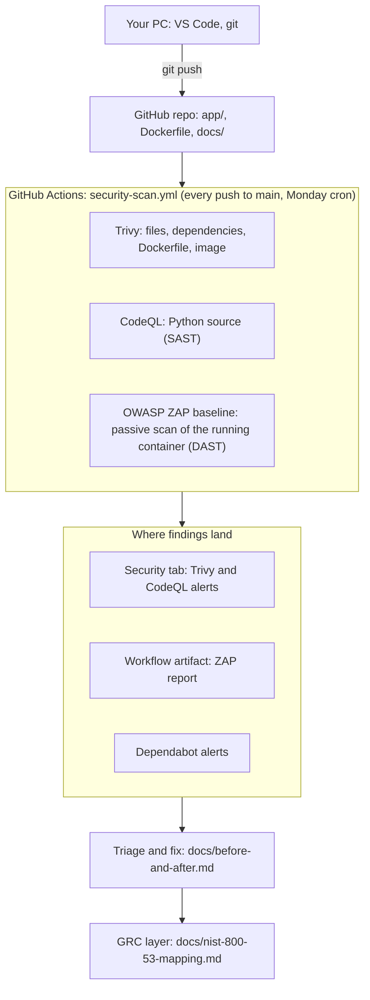

# devsecops-grc-pipeline

A small DevSecOps lab: a deliberately vulnerable Flask app, a GitHub Actions pipeline that scans it three ways, and a GRC layer that maps the pipeline to NIST SP 800-53.

> **Warning:** `app/` is intentionally vulnerable (SQL injection, reflected XSS, hardcoded secret, debug mode, outdated dependencies, root container). I planted every flaw myself so the scanners have something to find. Fictional data only. Do not deploy it.

## Status

Work in progress. Nothing below is claimed until it has run and the result is in this repo.

- [x] App, Dockerfile, and pipeline written
- [x] First pipeline run green on GitHub Actions (2026-10-28)
- [x] Baseline findings recorded (before counts): `docs/baseline-findings.md`
- [x] Fixes made and rescanned, after counts recorded (5 planned fixes plus 1 follow-up): `docs/before-and-after.md`
- [x] NIST SP 800-53 mapping, first version (control titles verified, judgments under review): `docs/nist-800-53-mapping.md`
- [x] Architecture diagram (renders on GitHub, 2026-10-31)

## Results

Scanned at tag `v0-baseline` (2026-10-28) and again at `v1-fixed` (2026-10-30). Details and fix log: `docs/before-and-after.md`.

| Source | Before | After |
|---|---|---|
| CodeQL (app code) | 3 | 0 |
| Trivy, my own files (`requirements.txt`, `Dockerfile`) | 19 | 0 |
| Dependabot | 17 | 0 |
| Trivy, built image | 187 | 164 |
| Code scanning total (CodeQL + Trivy) | 209 | 164 |

The 164 that remain are operating-system packages in the base image, which I did not plant and treat as accepted risk for this lab. Not fixed: the hardcoded `secret_key` (neither CodeQL nor Trivy flagged it) and the 9 ZAP header alerts. One of my fixes (upgrading pip) briefly added about 8 new alerts from pip's bundled libraries; removing pip from the final image closed them.

## Architecture

A change is pushed to GitHub, the three scan jobs run in GitHub Actions, and their findings land in the Security tab (Trivy, CodeQL), a downloadable artifact (ZAP) and Dependabot alerts. I triage the findings, fix the code, and push again. The GRC layer maps the controls this loop exercises to NIST SP 800-53.

## What each tool does

| Stage | Tool | What it checks | Where results go |
|---|---|---|---|
| SCA, secrets, IaC, container image | Trivy (Aqua Security's open-source scanner) | Known CVEs in dependencies and the image, secrets, Dockerfile misconfiguration | GitHub Security tab (SARIF) |
| SAST | CodeQL | Flaws in the Python source code | GitHub Security tab |
| DAST (passive) | OWASP ZAP baseline | Missing security headers, cookie flags, information leaks on the running app | Workflow artifact (HTML, JSON, Markdown) |

## Honest limits

- This uses Trivy, the open-source scanner from Aqua Security. It does not use Aqua's commercial platform.
- ZAP baseline is passive: it does not attack the app, so it will not find the SQL injection. CodeQL covers that.
- The target is a toy app I wrote, not production code. Finding counts show that the pipeline works, not how secure a real system is.

## Supply-chain note

Every third-party action in `.github/workflows/security-scan.yml` is pinned to a full commit SHA instead of a tag. In March 2026 the `aquasecurity/trivy-action` version tags were force-pushed to malicious code; a pinned SHA cannot be moved that way.
